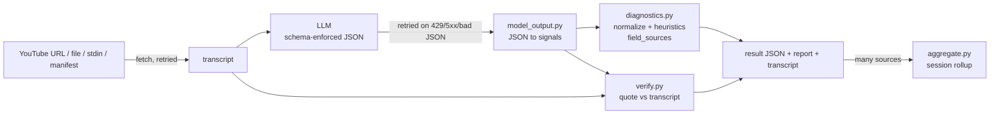

# WTP Signal Extractor

**Turns an interview or video transcript into checked evidence of willingness to pay.**

It asks an LLM where people show they would pay to fix a problem (and who stands in their way),
then **checks the answer itself**: every quote is matched against the transcript, and every
judgment is labelled with where it came from. It's built for an AI agent to run unattended, which
is also why it's pleasant for a person to run.

```console
$ uv run python main.py --replay raw.txt --transcript-file transcript.txt --json \
    | jq -c '{status, evidence: .evidence | {total, verified, approximate, stitched, not_found}}'
{"status":"ok","evidence":{"total":13,"verified":10,"approximate":1,"stitched":2,"not_found":0}}
```
<sub>Real output: a saved Gemini answer about wedding-industry lead platforms (video `939LlYN1aK8`),
re-checked offline against its transcript.</sub>

---

## Why it exists

Customers say they want many things. They **pay** for few. The tell is behavior, not opinion:
money already spent, tools bought and dropped, workarounds kept alive, "it cost us a client".
This tool pulls those moments out of long transcripts, separates them from wishful talk, and
maps them onto a go-to-market pipeline (FGP):

| Phase | Question it answers | Where it lands in the result |
|---|---|---|
| 0 | Who exactly is this niche, and how do they see themselves? | `pass2.subniche_culture_signals` |
| 1 | Is the pain real enough that they already pay? | `pass1.behavior_signals` vs `opinion_signals` |
| 2 | Does the pain break things for *their* customers too? | `pass2.cascade_indicators` |
| 3 | Who controls access (platforms, distributors, certifiers)? | `pass2.gatekeeper_mentions` |
| 3.5 | What does that gatekeeper protect? | `pass2.position_intelligence` |

It is the judging half of a planned loop with **Source Garden** (which decides *where* to look);
the `provenance` and `diagnostics.search_language_feedback` fields are that feedback path.

## Built for agents: no context left behind

An agent knows only what a tool tells it: the help text, stdout, stderr, the exit code, the
files it writes and the docs. Each of those is designed so an agent never has to guess.

| Non-negotiable | What it means here |
|---|---|
| **Control surface** | Every input is a flag (`--url`, `--transcript-file PATH\|-`, `--urls`, `--session`). It never waits for typing unless a person is at a terminal. `--check` tests config with no network; `--replay` re-parses a saved answer with no API call. |
| **Output contract** | `--json` puts exactly one JSON document on stdout; logs go to stderr. Exit codes: `0` ok, `1` degraded, `2` usage, `3` transcript failed, `4` model failed (a batch exits with the worst). Every result carries `status`, `schema_version` and the paths of every file written. |
| **Trust signals** | Quotes are graded against the transcript (`verified` / `approximate` / `stitched` / `not_found`). Each diagnostic says whether the `llm` or a `heuristic` produced it. `run` records model, prompt+schema hash, attempts and mode. Failures are results with an `error`, never tracebacks. |
| **Domain knowledge** | `--describe` prints the whole contract as JSON: flags, exit codes, every allowed value, every field, the FGP phases, gatekeeper types and registers. [AGENTS.md](AGENTS.md) is the operating manual. |

## Quickstart

```bash
uv sync
echo 'GEMINI_API_KEY=...' > .env        # or LLM_PROVIDER=openai_compatible + key + base URL
uv run python main.py --check           # config OK? (JSON, no network)

uv run python main.py --url "https://youtu.be/VIDEO_ID"           # human report
uv run python main.py --transcript-file interview.txt --json      # JSON on stdout
uv run python main.py --session manifest.json --json              # many sources + rollup
uv run python main.py                                             # interactive (terminal only)
```

A manifest is a list of sources (`url` or inline `transcript`) with optional Source Garden
context. Get a full example with `uv run python main.py --describe | jq .manifest_example`.

## How it works



1. **Fetch.** YouTube captions via `youtube-transcript-api`, or text you supply.
2. **Ask.** One call per source. The provider enforces `model_output.MODEL_OUTPUT_SCHEMA` while
   decoding (Gemini `response_json_schema`, OpenAI strict `json_schema`), so the reply is
   always parseable JSON with fixed vocabularies.
3. **Check.** `verify.py` grades every quote; `diagnostics.py` normalizes values, fills gaps with
   heuristics and records which is which.
4. **Write.** Per source: `*.json` (the result), `*.txt` (readable report), `*.transcript.txt`.
   Sessions add a rollup: recurring entities, gatekeeper types, register performance, status counts.

### Failure handling

| What failed | Retried? | Result |
|---|---|---|
| 429, 5xx, timeout, dropped connection | yes: exponential backoff, `WTP_MAX_ATTEMPTS` (3), `WTP_RETRY_BASE_DELAY` (2 s) | `run.attempts` shows how many |
| model reply is not valid JSON | yes, once more like a 5xx | `run.attempts.model` |
| bad key, unknown model (401/403/404) | no | `analysis_failed`, exit 4 |
| no captions, video unavailable, YouTube IP block | no | `transcript_failed`, exit 3 |
| one source in a batch | others continue | `status_counts` in the session |

## Trust model: what the evidence grades mean

| Grade | Meaning | Use it as |
|---|---|---|
| `verified` | exact span, ignoring case and punctuation | the speaker's words |
| `approximate` | ≥ 80% of the words, in order, in one stretch | the speaker's words, lightly edited |
| `stitched` | each sentence is real, but joined from different places or reordered | cite the pieces separately |
| `not_found` | not in the transcript | unproven; marks the run `degraded` |

**Measured, not assumed** (2026-10-14, three earlier Gemini runs replayed against their
re-fetched transcripts): 41 quotes → 28 verified, 6 approximate, **7 stitched**, 0 not_found.
The model joins sentences in about 1 quote in 6, which is why `stitched` exists and why the
prompt now forbids it. The same replay found that the old text parser had split every
position-intelligence signal in two; the schema-enforced path can't make that mistake.

## Configuration

| Variable | Default | Purpose |
|---|---|---|
| `LLM_PROVIDER` | `gemini` | or `openai_compatible` |
| `GEMINI_API_KEY` / `GOOGLE_API_KEY` | — | Gemini key |
| `GEMINI_MODEL_NAME` | `gemini-3.8-flash` | (`gemini-2.5-flash` now returns 404 for new users) |
| `OPENAI_COMPATIBLE_API_KEY`, `_BASE_URL`, `_MODEL_NAME` | —, —, `gpt-4.1-mini` | any server with the OpenAI Responses API and strict JSON schema |
| `WTP_MAX_ATTEMPTS`, `WTP_RETRY_BASE_DELAY` | `3`, `2` | retry policy |

`.env` is read from the working directory. `--check` reports whether a key is present, never the key.

## Repository

```
main.py            CLI: inputs, run modes, exit codes, stdout/stderr discipline
contract.py        versions, exit codes, statuses, the --describe document, domain glossary
prompt.py          what the model should look for (not the format)
model_output.py    JSON Schema the model must follow + adapter to internal signals
extract.py         parser for pre-0.3 plain-text outputs (kept so old runs can be replayed)
diagnostics.py     vocabulary normalization, heuristics, field_sources
verify.py          quote-to-transcript matching
retry.py           transient vs permanent errors, backoff
aggregate.py       session rollups
render.py          human-readable reports
session_store.py   artifact files
schemas.py         result skeleton and allowed values
providers/         Gemini and OpenAI-compatible adapters
tests/             unit, contract and end-to-end tests (no network)
AGENTS.md          operating manual for AI agents (CLAUDE.md imports it)
```

```bash
uv run python -m unittest discover -s tests -t .     # 63 tests, ~13 s, no network
```

## Limits

- Sources run one at a time.
- Quote matching is lexical. A faithful paraphrase is `not_found`, and a short common phrase can
  match by chance (only quotes of three or more words count as stitched fragments).
- Heuristic diagnostics are keyword rules: useful as a fallback, labelled as such, not as good
  as the model's direct answer.
- Source Garden integration exists only as JSON fields; nothing calls across repos yet.
- Live model behavior is only as reliable as the provider: during testing on 2026-10-14, Gemini's
  flash models returned 503 "high demand" for several minutes at a time.
